  

  <strong>From domain logic and data modeling to reliable products in production.</strong>

  
  

  
  

  <a href="#about">About</a>
  &nbsp;&nbsp;•&nbsp;&nbsp;
  <a href="#toolkit">Toolkit</a>
  &nbsp;&nbsp;•&nbsp;&nbsp;
  <a href="#selected-work">Selected work</a>
  &nbsp;&nbsp;•&nbsp;&nbsp;
  <a href="#contact">Contact</a>

## `01` — About

### Software Engineer — Systems, APIs & Platforms

I design and deliver reliable software products across backend, web, mobile, and desktop environments. My work covers the complete engineering lifecycle: domain modeling, API design, data architecture, application development, testing, automation, and production delivery.

**Core stack:** PHP, Laravel, SQL, Kotlin, TypeScript, Docker, and GitHub Actions.

**Areas of expertise:** API and platform engineering, data modeling, authentication and authorization, multi-tenancy, application architecture, automated testing, and CI/CD.

PHP and Laravel are central to my work, complemented by Kotlin and Jetpack Compose for Android, React Native and TypeScript for cross-platform applications, and JavaFX for desktop solutions. My experience includes job-search and real estate platforms, multi-tenant SaaS, e-commerce, personal finance, and management systems.

## `02` — Engineering toolkit

A pragmatic toolkit for designing, building, testing, and shipping maintainable products.

### Languages

  
  
  
  
  
  
  
  

### Backend and APIs

  
  
  

### Web development

  
  
  
  
  
  
  
  
  
  

### Mobile and desktop

  
  
  

### Design and prototyping

  

### Data and persistence

  
  
  
  
  
  
  

### Architecture and patterns

  
  
  
  

### Testing and code quality

  
  
  
  

### DevOps and platforms

  
  
  
  

### Development tools

  
  
  
  
  

## `03` — Engineering capabilities

- Design and implementation of services, APIs, integrations, and domain workflows.
- Data modeling, schema evolution, and integration with SQL and NoSQL databases.
- Secure authentication, authorization, RBAC, tenant isolation, and permission models.
- Web, Android, cross-platform, and desktop applications backed by production data.
- Modernization of existing systems through clear boundaries and maintainable architecture.
- Automated testing, static analysis, containerization, CI/CD, and deployment workflows.

## `04` — Selected work

<table>
  <tr>
    <td width="104" align="center" valign="middle">
      
    </td>
    <td valign="top">
      <strong><a href="https://github.com/Angel11R99/Mony" target="_blank" rel="noopener noreferrer">Mony</a> — Private, offline-first personal finance for Android.</strong> 
      Transactions, budgets, goals, statistics, exports, scanning, and 11 home-screen widgets. Financial data stays on the device.  
      
      
      
      
    </td>
  </tr>
</table>

<strong>Built with:</strong> Kotlin · Jetpack Compose · Room · Hilt · Coroutines · Flow

## `05` — Let's build something useful

  <strong>Have a product challenge, an API to design, or a system to modernize?</strong> 
  I am available for remote collaboration.

  

  

  Designed with intent. Engineered for clarity.

